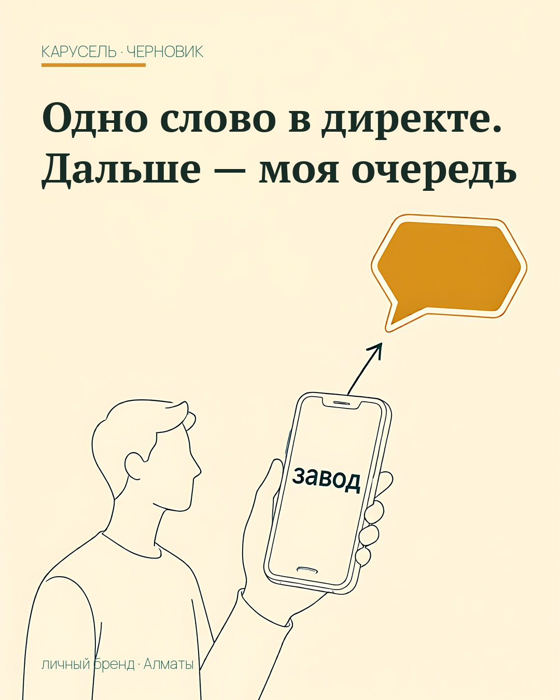

# Одно слово в директе. Дальше — моя очередь

**Слайд 1**  
Одно слово в директе.  
Дальше не вы выбираете форму. Дальше я.

**Слайд 2**  
Форма не нужна.  
Просто напишите «завод». Никакой регистрации и пустых полей.

**Слайд 3**  
Я получаю вашу тему.  
Вы присылаете одну мысль — пример, вопрос или задачу. Всё остальное я разбираю сам.

**Слайд 4**  
Мой ход внутри завода.  
Радар ставит вашу тему в очередь. Автор пишет черновик по библии стиля. Я убираю пластик и непроверенные цифры.

**Слайд 5**  
Ответ в течение дня.  
Если тема рабочая — вы получите структуру или готовый материал. Если нет — скажу прямо и без воды.

**Слайд 6**  
Цена — предложение.  
Пилот «2 агента под ключ» стоит от 80 до 120 тысяч тенге. Можно платить частями через Kaspi. Это вариант, не обязательство.

**Слайд 7**  
Что в этот шаг не входит.  
Гарантии охватов, ежедневное ведение аккаунта за вас и работа без вашего участия как редактора.

**Слайд 8**  
Напишите «завод» в директ.  
Отвечу в течение дня и покажу механику на вашей теме.

---

**Подпись**  
Одно слово в директе. Дальше собираю я. Без формы, без обязательств.

Пилот «2 агента под ключ» — цена как предложение, 80–120 тыс. ₸, Kaspi. Если тема рабочая — пришлю ответ в день обращения.

Напишите «завод».

#алматы #контентзавод #агенты

---

**Самоотчёт:** вычеркнул упоминания «гарантий охвата» и любые оценочные слова; заменил общие фразы на конкретный шаг приёма темы; добавил границу в предпоследнем слайде; сократил длинное предложение в слайде 4 до двух коротких для удобства чтения на экране.

---
Одобрено в Telegram 19.11.2026 18:15 (Алматы). Формат: карусель 8 слайдов.
